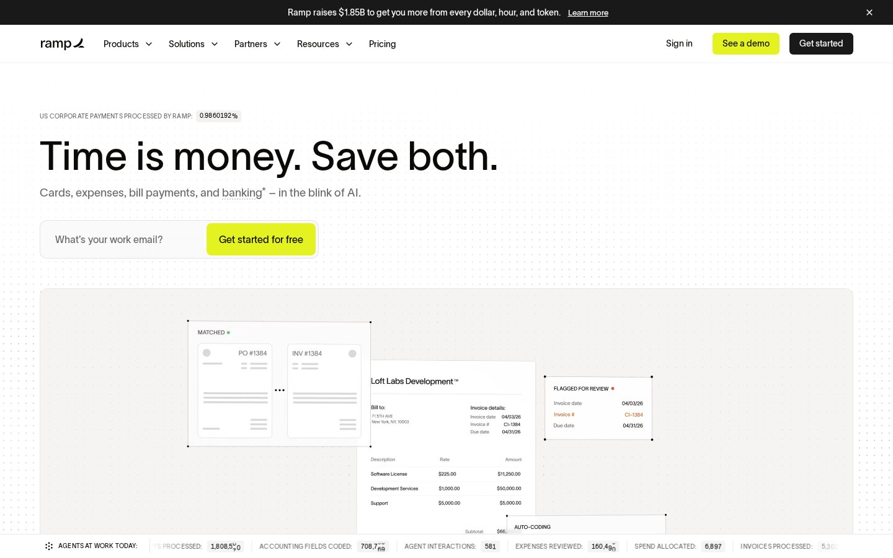
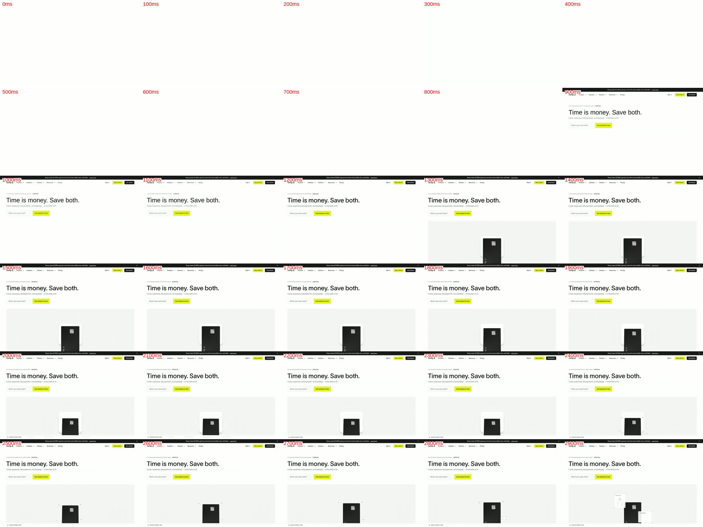
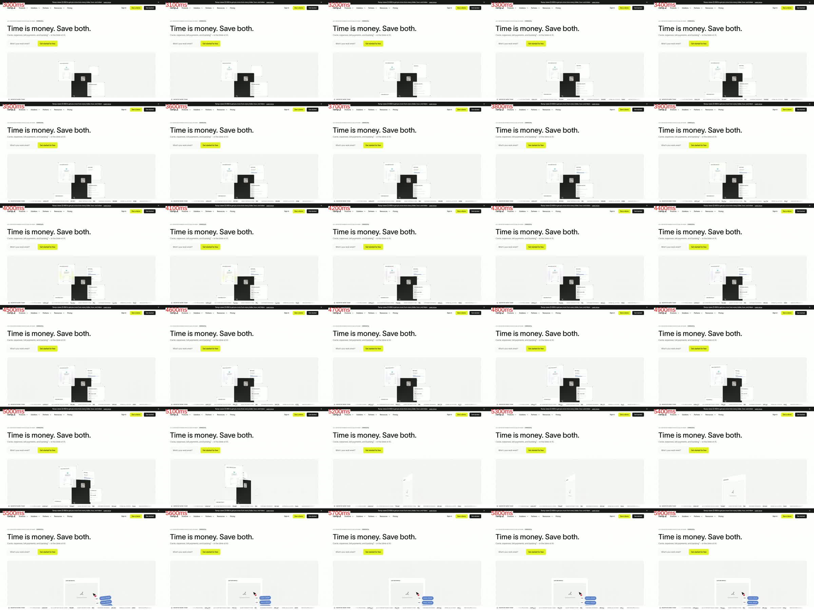
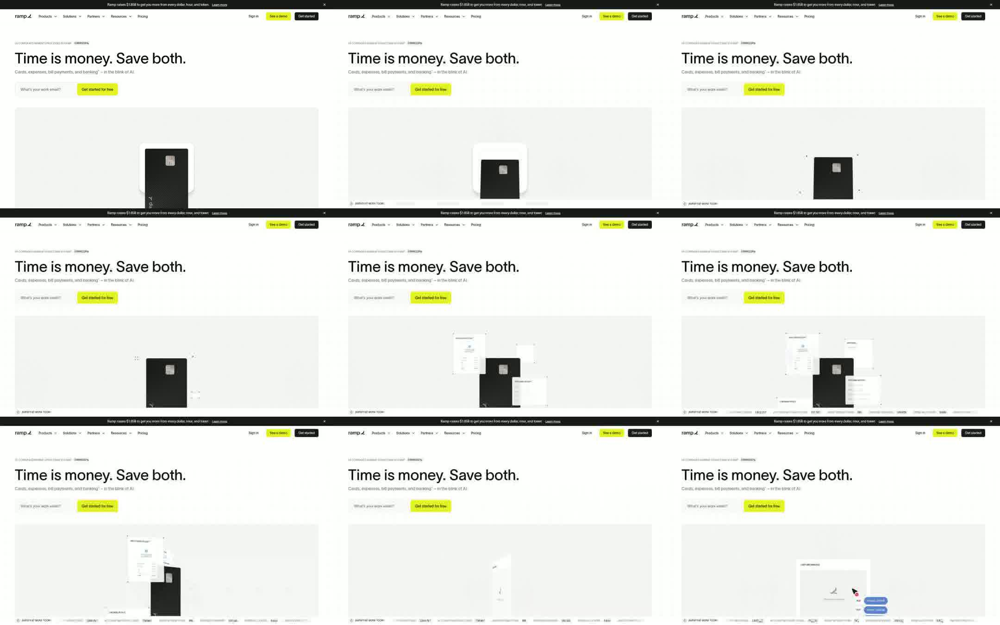
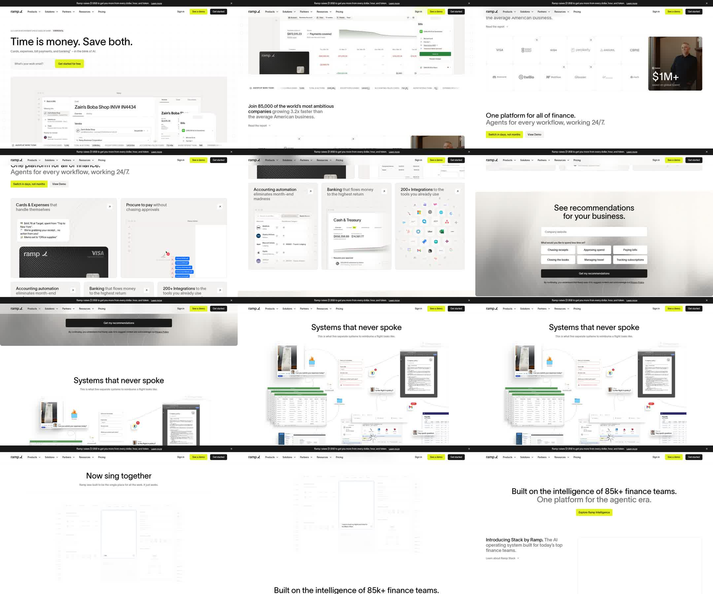
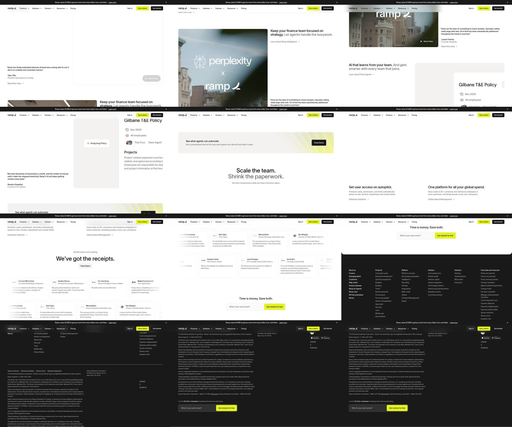
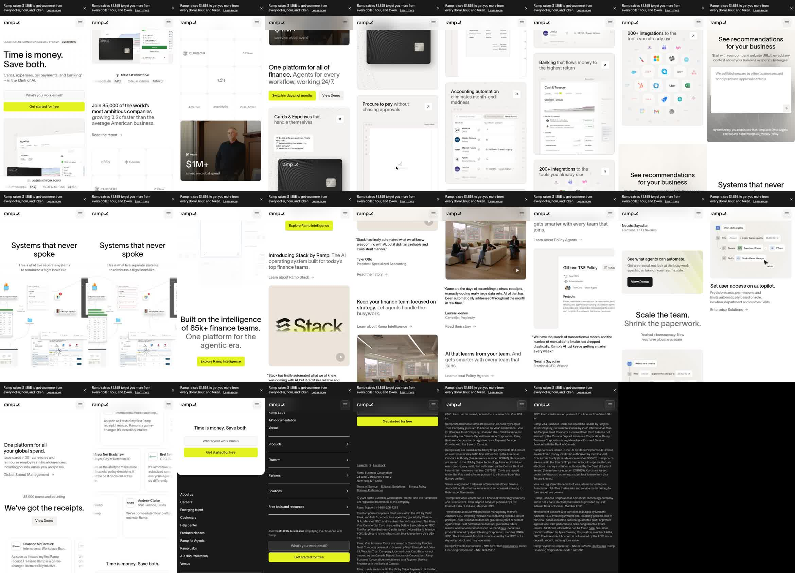

# Ramp como referencia (14/11/2026)

Nicolas eligió ramp.com como modelo para el hero y el formato de la página.
Capturas de ramp.com tomadas el 14/11/2026, solo como referencia interna: no se copian
textos ni imágenes de Ramp.

## Por qué se ve premium y da confianza

1. **Mucho aire y pocos colores.** Fondo blanco, texto negro y gris, y un solo color de acento (lima) reservado para el botón principal. Nada compite con el titular.
2. **Un titular corto y grande.** Unos 64 px, peso medio, interletrado cerrado, en una sola línea. El subtítulo va en gris, a la mitad de tamaño, y entra en una línea.
3. **El producto real es el protagonista.** Debajo del CTA hay un escenario gris claro, ancho como la página, con una escena que se arma sola: el objeto central sube, aparecen marcas de selección y alrededor se abren documentos. Después cambia de escena.
4. **La prueba aparece enseguida.** Hay un contador en vivo arriba del titular y una tira de contadores abajo del escenario. Después vienen los logos, un caso con su número, citas con nombre y cargo, y un muro de testimonios. Cada afirmación tiene un dato al lado.
5. **Ritmo constante.** Los titulares de sección van en dos tonos (negro y gris), con la misma escala en todas las secciones. Las tarjetas son gris claro y tienen radios chicos. Hay un CTA repetido al final, sobre una tarjeta blanca que pisa el footer negro.

## Coreografía de entrada (primeros 6 s a 1440, video a 10 cuadros por segundo)

| Tiempo | Qué pasa | Movimiento |
|---|---|---|
| 0–0,9 s | Carga. | — |
| 0,9 s | Barra de anuncio, cabecera, eyebrow, titular, subtítulo y CTA, todo junto. | Sin animación: el texto está quieto desde el primer cuadro. |
| 1,3 s | Aparece el escenario gris. El objeto central (la tarjeta, dentro de un soporte blanco) sube desde abajo. | Traslado vertical de unos 120 px con desaceleración larga (ease-out tipo expo), unos 900 ms. |
| 1,9–2,2 s | El soporte baja y se va; la tarjeta queda sola. | Traslado y fundido, unos 300 ms. |
| 2,0 s | Abajo entra la tira "agentes trabajando hoy" con contadores. | Fundido. Los números ruedan dígito por dígito, como un odómetro, y siguen subiendo. |
| 2,4 s | Cuatro puntitos marcan las esquinas de la tarjeta, como una selección. | Aparecen y se separan hacia afuera. |
| 2,6–3,2 s | Desde atrás de la tarjeta salen tres o cuatro documentos, cada uno con sus esquinas marcadas. | Escalan de unos 0,9 a 1 y se desplazan hacia su lugar, escalonados cada unos 120 ms. |
| 3,2–5,0 s | Los documentos "trabajan": se resaltan campos y aparecen estados ("Matched", "Flagged"). | Cambios chicos, sin moverse de lugar. |
| 5,0–5,4 s | Fin de la escena: los documentos se pliegan hacia el centro y la tarjeta gira a una vista de canto. | Unos 400 ms. |
| 5,4 s en adelante | Empieza la escena siguiente: una ventana de captura, un cursor que entra y etiquetas azules que aparecen una por una. El ciclo sigue. | — |

## La página, sección por sección (1440)

1. **Barra de anuncio** negra, de una línea, que se puede cerrar. **Cabecera** blanca y fija, con línea fina abajo. Tiene dos botones a la derecha: "See a demo" en lima y "Get started" en negro.
2. **Hero.** Eyebrow con un contador vivo, H1, subtítulo, y campo de mail con el botón pegado dentro de un mismo borde. Abajo, el escenario animado, que sale de la primera pantalla, y la tira de contadores.
3. **Prueba social.** A la izquierda, una frase con dato ("85.000 empresas…") y un link al informe. A la derecha, una grilla de logos separada por cruces finas, más una tarjeta de caso con video y una cifra.
4. **"Una plataforma para todo."** Titular en dos tonos y dos botones. Abajo, un bento: dos tarjetas grandes y tres chicas, cada una con un título en dos tonos, una flecha y la interfaz del producto adentro. Las tarjetas entran con un fundido al hacer scroll.
5. **Banda gris interactiva.** "Ver recomendaciones para tu negocio": un campo, opciones para tocar y un botón.
6. **El problema contado con scroll.** "Sistemas que nunca se hablaron" muestra un collage desordenado de pantallas. Queda fijo mientras se hace scroll y se reordena en una sola ventana: "Ahora cantan juntos".
7. **Bloque de inteligencia.** Titular centrado en dos tonos con CTA. Después, tres filas alternadas con texto, link e imagen o video grande, cada una con una cita de cliente con nombre y cargo.
8. **Banner de CTA** horizontal: texto a la izquierda y botón negro a la derecha.
9. **"Escalá el equipo."** Titular centrado y dos columnas con funciones, cada una con una animación de interfaz.
10. **Muro de testimonios.** "85.000 equipos y contando". Dos filas de tarjetas que se desplazan solas en sentidos opuestos.
11. **CTA final.** Titular y campo de mail sobre una tarjeta blanca con las esquinas de abajo redondeadas, que pisa el **footer** negro. El footer tiene columnas de links, legales y otro campo de mail.

En 390 el orden es el mismo. Todo queda en una columna, el bento pasa a tarjetas apiladas y el menú se reduce a la hamburguesa.

